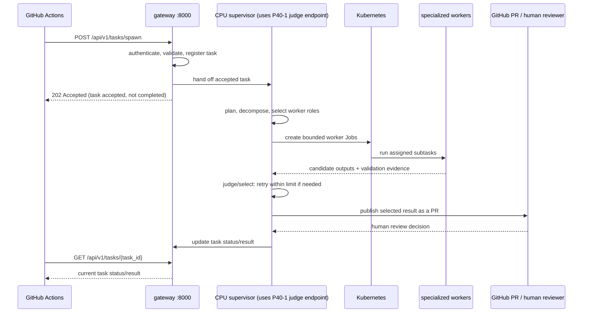
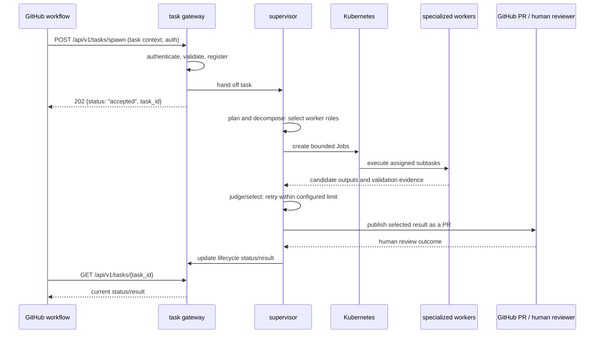
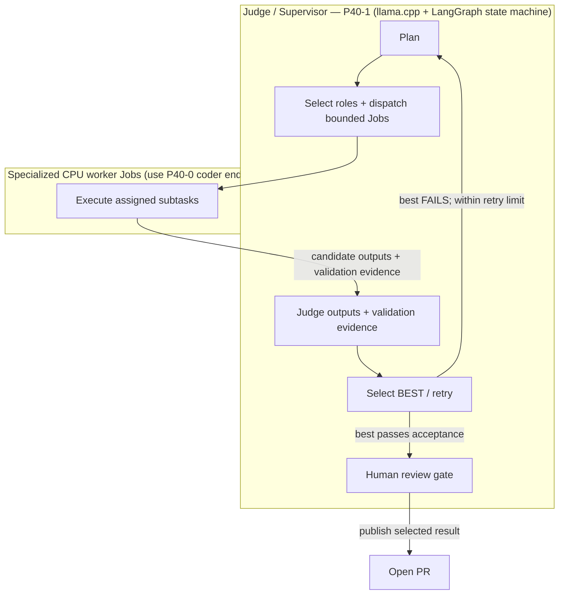
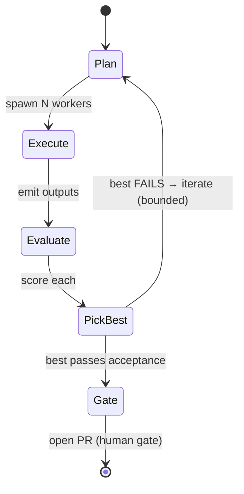

# Thinktank Planning Document — AI Agent Orchestration on k8s-node01

**Status:** `APPROVED` · **For user validation** · **Date:** 2026-10-10

> This document started life as a WIP design that needed your sign-off. It has now
> been **approved** (content sign-off, 2026-10-10) but **is not being built**. The
> remaining `STILL-OPEN` item is tracked in §8 for validation. Approval records
> the target architecture; it does not authorize implementation.

**One-line summary:** Turn `k8s-node01` into an always-on, autonomous AI software
factory — a Qwen2.5 **supervisor/judge** on P40-1 orchestrates CPU **worker
Jobs** using the Qwen2.5 coder endpoint on P40-0 via a LangGraph state machine, evaluates and picks the best
output, retries on failure, and opens a PR through a human-review gate. Runs
continuously 24/7 as a resident service, independent of VS Code, monitored
through the selected central Prometheus + Grafana on TrueNAS and iDRAC telemetry.

---

## 1. Context — verified facts

All facts in this section are **verified on the actual hardware** of
`k8s-node01`. Nothing here is invented.

### 1.1 Hardware

| Component | Detail |
| :--- | :--- |
| **Orchestration** | K3s |
| **Container runtime** | containerd |
| **CPU** | Intel Xeon Gold 6148 @ 2.40 GHz — 80 cores |
| **RAM** | 91 GiB total · 87 GiB free · Swap 8 GiB |
| **STORAGE** | `/mnt/k8s-data-ssd` — 3x SSD RAID5 (~1.9 TB xfs, replicated) · `/mnt/k8s-local-nvme` — ~1.9 TB NVMe |
| **GPU** | 2x NVIDIA Tesla P40 (Pascal GP102, 23 GB VRAM each) | — NO tensor (CUDA) cores · ~94 GB/s memory bandwidth | — PCIe Gen3 x16 · NO NVLink |
| **MGMT** | iDRAC (iDRAC9 Enterprise BMC controller) |
| **DRIVER** | nvidia 580.178.04 (CUDA 13.0 runtime) · nvcc toolchain 12.4 | |

### 1.2 Target platform constraints and required integrations

| Area | Target constraint or integration |
| :--- | :--- |
| Kubernetes | Deploy on the K3s cluster using containerd and the NVIDIA device plugin; GPU scheduling must expose `nvidia.com/gpu`. |
| Inference | Provide separate OpenAI-compatible coder and judge endpoints, each bound to its assigned P40 and serving Qwen2.5-Coder-7B-Instruct-GGUF @ Q4_K_M with a 32K (32768) context. |
| Inference routing | Expose the required OpenAI-compatible API through the cluster ingress; keep the judge endpoint available to the supervisor and coder endpoint available to worker Jobs. |
| Model storage | Keep model weights on persistent storage backed by the node's SSD/NVMe capacity. |
| Agent runtime | Run the gateway and always-on supervisor as independent services with their own tool execution; the target runtime must not depend on VS Code or a VS Code extension. |
| Monitoring | Integrate node and iDRAC telemetry with the selected central Prometheus + Grafana backend on TrueNAS. Do not add a second Prometheus/Grafana stack to the node. |

---

## 2. Design overview

### 2.1 The two-brain architecture

The core idea is a **split-brain** on the two physical GPUs: one brain **writes
code** (coder), the other **judges** it (supervisor). They are the same model
family (Qwen2.5), which keeps the judge's evaluations meaningful.

| GPU | Target inference role | Model and context | Role | Interface |
| :--- | :--- | :--- | :--- | :--- |
| P40-0 | Coder inference endpoint | Qwen2.5-Coder-7B-Instruct-GGUF @ Q4_K_M · 32K (32768) | Supplies code generation to bounded worker Jobs | Role-specific OpenAI-compatible API endpoint |
| P40-1 | Judge inference endpoint | Qwen2.5-Coder-7B-Instruct-GGUF @ Q4_K_M · 32K (32768) | Supports supervisor planning, evaluation, selection, and retry decisions | Role-specific OpenAI-compatible API endpoint, accessible to the supervisor |

- **Coder brain (P40-0):** a `llama.cpp` inference server running the approved
  Qwen2.5 coder model at the approved 32K context. It supplies inference to
  specialized worker Jobs.
- **Judge brain (P40-1):** a `llama.cpp` inference server running the same
  approved model family and context. The supervisor uses it to plan and decompose
  work, select worker roles, evaluate candidate outputs and validation
  evidence, decide whether to retry, and control publication through the human
  review gate.
- **Always-on task gateway (port 8000):** accepts submissions from an external
  GitHub workflow, authenticates and validates them, registers each task, and
  hands accepted tasks to the supervisor. It is the task intake and status
  boundary; it does **not** create worker Jobs or judge worker results.



#### 2.1.1 Task-acceptor API reference

The task gateway is an always-on HTTP service on port **8000**. It is the
external workflow's persistent intake and status boundary. The gateway
authenticates and validates submissions, registers accepted tasks, and hands
them to the supervisor. The supervisor owns planning, worker selection, bounded
Job dispatch, collection and judgment of candidate results, retries, and the PR
human gate. A `202 Accepted` response means only that the task was accepted for
processing; it does not mean the task is complete.

##### Endpoints

| Method | Endpoint | Purpose |
| --- | --- | --- |
| `POST` | `/api/v1/tasks/spawn` | Authenticate, validate, register, and hand a task to the supervisor. Does not spawn a worker. |
| `GET` | `/api/v1/tasks/{task_id}` | Read the task's current status and, when available, its selected result and PR details. |

##### Authentication

Actions task submission and retry require a verified, repository-bound OIDC JWT:

```
Authorization: Bearer <actions-oidc-jwt>
```

Repository access uses GitHub App installation tokens only. Exact workflow and
immutable repository bindings authorize submission. Management uses a distinct
service token for policy-approved identities and task status, never repository PATs.
See [credential separation](../operations/credential-separation.md).

##### Request payload — task registration

The task-registration payload (`POST /api/v1/tasks/spawn`) carries the issue/PR
context needed by the supervisor:

| Field | Meaning |
| --- | --- |
| `task_id` | Identifier for the task. |
| `repo` | Required repository path, validated against the source-repository credential. |
| `issue_number` | Issue / PR number. |
| `issue_title` | Issue / PR title. |
| `issue_url` | Issue / PR URL. |

##### `task_id` derivation

The `task_id` value is derived in this order of precedence:

1. the `task_id` field of the payload;
2. otherwise the `id` field;
3. otherwise it falls back to `issue_number` (the issue / PR number).

##### Validation rules and status codes

| Status | When | Body |
| --- | --- | --- |
| `202` | Task registered and handed to the supervisor for processing; completion is not implied. | `{status: "accepted", task_id, repo, endpoint: "/api/v1/tasks/spawn"}` |
| `400` | Malformed JSON body. | `{"error": "invalid-json"}` |
| `403` | Repository credential validation or transport policy failed. | `{"error": "repository-credential-denied"}` (example) |

The repository must be supplied explicitly; it is not inferred from environment configuration.

##### Related endpoints

- **`GET /api/v1/tasks/{task_id}`** — poll the supervisor-owned task status.
  The gateway returns the current lifecycle state; when available, it includes
  the selected result and PR details. Candidate evaluation and status updates
  are owned by the supervisor, not submitted as a worker final-evaluation call.

  ```
  {task_id, status, result, pull_request_url}
  ```

  Lifecycle status may include `accepted`, `planning`, `running`, `validating`,
  `retrying`, `awaiting_review`, `completed`, or `failed`. `completed` follows
  the supervisor's bounded workflow and human-gate outcome; `awaiting_review`
  indicates that the selected result has been published for human review.

##### Task lifecycle



##### Deployment

The external GitHub workflow submits issue/PR context to
`POST /api/v1/tasks/spawn` and may poll `GET /api/v1/tasks/{task_id}`. The
gateway remains the intake/status boundary; the supervisor is the sole owner of
worker Job creation and task orchestration.

### 2.2 The LangGraph loop

The supervisor drives a **LangGraph state machine** — the loop is the heart of
the design:



**Loop semantics (design intent):** the supervisor plans and decomposes the
task, selects specialized roles, and dispatches bounded worker Jobs. Workers
return candidate outputs and validation evidence. The supervisor judges and
selects the best candidate, or creates a fresh plan and retries within the
configured maximum. For a passing candidate, the supervisor publishes a PR and
waits at the human review gate. See §8 for the confirmed iteration limit and
worker-count policy `N`.

### 2.3 Specialized-agent architecture

The design should not be treated as a single monolithic coding agent with one
model doing everything. The more robust pattern is a **specialized multi-agent
loop** in which each role gets the model best suited to that task:

| Role | Purpose | Preferred model profile | Why |
| :--- | :--- | :--- | :--- |
| **Supervisor / planner** | Reads the issue, decomposes the task, chooses the strategy, sets iteration budget, selects worker roles, dispatches Jobs, and owns final selection and publication | approved Qwen2.5-Coder-7B model, used for planning and tool selection | good at planning, judgment, and tool selection |
| **Coder workers** | Make the actual repo edits, run targeted validation, and produce patch candidates | approved Qwen2.5-Coder-7B coder endpoint | good at direct code generation and narrow test-driven edits |
| **Judge / reviewer** | Provides rubric-based candidate assessments and regression findings to the supervisor; the supervisor makes the final selection | approved Qwen2.5-Coder-7B model, focused on rubric-based evaluation | better at comparing competing outputs than generating them |
| **Verifier / test runner** | Executes focused build/test commands and returns validation evidence for supervisor review | deterministic shell/tooling | this role is about validation and signal collection, not creative synthesis |
| **PR / summary writer** | Drafts the PR body, changelog summary, and review notes for supervisor-controlled publication | supervisor using the approved Qwen2.5-Coder-7B 32K endpoint | keeps the final artifact human-readable and review-ready |

**Key architectural rule:** the supervisor is the end-to-end task orchestrator
and final decision maker, not a second full coder. It chooses the specialized
worker roles and bounded subtasks; workers return candidate outputs and
validation evidence. Workers do not own task orchestration, final judging, or
publication. The supervisor selects or retries candidates and controls PR
publication and the human gate.

**Delegation pattern:**

1. the **supervisor** defines success criteria, decomposes the task, and selects
  specialized worker roles;
2. bounded **worker Jobs** produce candidate patches and report validation
  evidence;
3. the **supervisor** judges candidates against the acceptance rubric, selects
  the result, and retries within the configured limit when needed;
4. specialized validation or summary roles may provide evidence or draft
  material, but the **supervisor** controls PR publication and the human gate.

This pattern is intentionally **role-based**, not just “one supervisor + N workers.”
The strongest system-level optimization is not raw model size, but **matching the
model to the problem type** while preserving a single, bounded human review gate.

### 2.4 Agent model matrix

For a single-node `k8s-node01` cluster with two P40 cards, the target uses the
approved Qwen2.5-Coder-7B model for both inference endpoints. The roles remain
specialized through their prompts and orchestration: the supervisor plans and
judges, while CPU worker Jobs use the coder endpoint for patch generation. The
human review gate remains the final publication boundary.

| Agent role | Recommended model | Context size | Why this fits | Runtime posture |
| :--- | :--- | :---: | :--- | :--- |
| **Supervisor / planner** | **Qwen2.5-Coder-7B-Instruct-GGUF** @ Q4_K_M | **32K** | approved target model for decomposing the issue, choosing the strategy, and routing work within the single-P40 budget | resident, always-on |
| **Coder worker** | **Qwen2.5-Coder-7B-Instruct** (GGUF Q4_K_M) | **32K** | best quality/latency tradeoff for patch generation; low VRAM footprint fits a P40 cleanly | short-lived worker Job |
| **Judge / reviewer** | **Qwen2.5-Coder-7B-Instruct** (GGUF Q4_K_M) | **32K** | same family as the workers keeps evaluation meaningful without making the judge too expensive | resident, always-on |
| **Verifier / test runner** | Deterministic shell/tooling | N/A | executes focused validation and returns evidence; no separate model endpoint is required | short-lived helper |
| **PR / summary writer** | **Qwen2.5-Coder-7B-Instruct-GGUF** @ Q4_K_M | **32K** | the supervisor uses its approved endpoint to produce the final summary and review notes | supervisor runtime |

**Practical default:**

- **Planner:** 7B, 32K
- **Coder workers:** 7B, 32K
- **Judge:** 7B, 32K
- **Verifier:** deterministic validation tools
- **PR summary:** supervisor, 7B at 32K

This preserves the approved **32K Qwen2.5-Coder-7B** configuration on each
inference role while assigning planning, code generation, and evaluation to
distinct agent roles.

### 2.5 Deployment posture

- **Always-on `Deployment` (not `CronJob`).** The whole system must be ready the
  moment a task arrives — a scheduled job would add latency and a cold-start gap.
- **Runs continuously 24/7** and **survives restarts**: the loop state is persistent
  so a restart resumes where it left off rather than re-planning from scratch.
- **Autonomous & independent of VS Code:** the always-on agent runs inside the
  `orchestrator` Deployment with its own tool-calling. It does **not** use Cline,
  Continue, or any VS Code extension. This is deliberate (see §4).

---

## 3. Decisions table

Every decision is tagged. `CONFIRMED` = approved target-design choice.
`STILL-OPEN` = requires validation before implementation is considered.

| # | Decision | Tag | Choice | Key reasoning / open question |
| :--- | :--- | :--- | :--- | :--- |
| 1 | **Two-brain split** | ✅ CONFIRMED | P40-0 = Qwen2.5 **coder** (llama.cpp); P40-1 = Qwen2.5 **judge/supervisor** (llama.cpp). Same model family so the judge is meaningful. | VRAM fit: 2× 7B Q4_K_M (~4.68 GB each) fit on **separate** P40s, ~18 GB spare per card. |
| 2 | **Orchestration framework** | ✅ CONFIRMED | **LangGraph** state machine for the loop. | Supervisor plans/decomposes → selects roles and dispatches bounded Jobs → workers return candidate patches and validation evidence → supervisor judges/selects, retries within limit, and controls PR publication (human gate). |
| 3 | **Always-on vs scheduled** | ✅ CONFIRMED | **Always-on `Deployment`** (not CronJob). | Must be ready the instant a task arrives; survives restarts with persistent state. |
| 4 | **Agent runtime independence** | ✅ CONFIRMED | The always-on agent runtime has its own tool-calling and is **independent of VS Code and VS Code extensions**. | The agent must operate as a resident service without an editor session or editor-specific tools. |
| 5 | **Separate desktop interactive-chat workload** | ✅ CONFIRMED | RTX 3080 10 GB with **Ornith-1.5-9B-GGUF, 64K context**. | This separate workload is outside the target agent architecture and does not constrain either P40 endpoint. |
| 6 | **Monitoring** | ✅ CONFIRMED | Integrate with the selected central Prometheus + Grafana backend on TrueNAS. Add **node-exporter** (whole box) and **iDRAC telemetry** (IPMI — iDRAC9 Enterprise 7.00.00.184, IPMI Version 2.0). | Do **not** add a second Prometheus/Grafana on the box. iDRAC9 Enterprise (IPMI 2.0) → IPMI path chosen; Redfish not used. |
| 7 | **Resource budget** | ✅ CONFIRMED | Ample headroom; agents CPU/Ram limited by `limits` so they never steal from inference. GPU is the only hard constraint. | CPU 80 cores (orchestrator+workers ~10), RAM 91 GiB (inference holds ~9.4 GiB), 1.9 TB SSD. GPU P40s dedicated to inference/judge. |

### 3.1 Approved model and context

The target coder and judge inference endpoints both use
**Qwen2.5-Coder-7B-Instruct-GGUF @ Q4_K_M** (~4.68 GB) with a **32K (32768)
context window**. The model family and context are approved choices, not open
alternatives. Each 7B model fits comfortably on its assigned 23 GB P40, with
approximately 18 GB of VRAM headroom. The desktop RTX 3080 interactive-chat
profile is a separate workload and does not define the agent's context size.

### 3.2 Model preferences (design constraints)

- HF-hosted, **32K (32768)** context — **the chosen window** (locked; VRAM fit is
  not the gate — both 7B models fit a single P40).
- Qwen-compatible (so the judge stays in the same family as the coder).
- Preference for HF-preferring quantizations.
- Quality floor: "35B and less gives satisfying quality."
- **Chosen model: Qwen2.5-Coder-7B-Instruct-GGUF @ Q4_K_M** (~4.68 GB, one
  P40). **RESOLVED** — 7B is the selected model; it fits a single P40 at Q4_K_M.
  Validation of the selected configuration remains a design-validation activity
  (see §9).

> **Note on VRAM headroom (independent of this):** the P40 VRAM (23 GB/card, 46
> GB combined) is the real constraint. The *chosen* models (Qwen2.5-Coder-7B at
> Q4_K_M, ~4.68 GB) sit far below the limit — both brains fit on a single card
> with ~18 GB of spare VRAM. The only model that does **not** fit a single P40 is
> a 32B one, which is why we deliberately avoid it; a 32B Q4_K_M (~26–28 GB)
> would need *both* P40s stacked (46 GB combined) and would be uncomfortably
> tight. The selected 7B model at the approved 32K context fits one P40 with room
> to spare.

---

## 4. Workload & resource budget

Budget table by namespace. The point is to show **headroom** so the overnight
agent is never starved of CPU/RAM while inference is pinned to the GPUs.

| Namespace | GPUs | cores (req/lim) | GiB (req/lim) | notes |
| :--- | :--- | :--- | :--- | :--- |
| **inference** (inference) | 2× P40 (coder+judge) | inference pins | ~4.7 GiB (VRAM, per model) | both brains are 7B @ Q4_K_M; GPUs hold weights in VRAM; node RAM is a separate pool, CPU/RAM is separate from VRAM |
| **orchestrator** (supervisor/judge brain) | 0 | ~2–3 lim | ~4–6 lim | supervisor/judge brain |
| **workers** (coder, N parallel) | 0 | ~6–7 lim | ~6–8 lim | coder agents |
| **node-exporter / monitoring agents** | 0 | ~1 lim | ~1 lim | monitoring |
| **SUM (agents)** | 0 | ~10 cores | ~12–15 GiB | headroom for monitoring |
| **NODE TOTAL** | 2× P40 | 80 cores | 91 GiB (87 free) | GPU is the only hard constraint |

**Budget rules (all CONFIRMED):**

- **CPU:** 80 cores. Agents are **`limits`-capped** so they never steal from
  inference. Orchestrator + workers use roughly **10 cores** — ~12–13 % of the
  node. The Xeon Gold 6148 (80 cores) is a wide margin.
- **RAM:** 91 GiB total, 87 GiB free. The GPUs hold their weights **in VRAM** (~9.4
  GiB across both P40s for two 7B models); node RAM is a separate pool for the
  agents + monitoring.
  Ample headroom.
- **Disk:** 1.9 TB SSD (replicated) + 1.9 TB NVMe. Plenty for agents, weights,
  logs, and telemetry.
- **GPU:** the P40s are the **constraint**, dedicated to inference + judge. CPU /
  RAM / disk are never the binding resource.

> **Note on VRAM vs RAM:** the "~46 GiB" figure in the table is **VRAM** (GPU
> memory), not node RAM. Node RAM (91 GiB) is a distinct pool and stays free for
> the agent. Keep these straight.

### 4.1 Normal operation distribution

The agents are a mix of **always-resident** and **bursty-on-demand**. The
system is **spiky, not steady**: two small models sit resident on the GPUs, and
brief parallel bursts of work happen when a task arrives. Across a 16h window,
most of the time is idle.

**Role distribution (always-on vs. bursty):**

| Agent | Always-on? | Active % | Notes |
| :--- | :--- | :--- | :--- |
| **Judge** (P40-1, 7B) | Yes, resident | ~5–10% | Bursts: plan → eval → gate, then idle |
| **Coder inference endpoint** (P40-0, 7B) | Yes, resident | ~5–10% | Supplies inference during parallel worker bursts, then idle |
| **Orchestrator** (CPU, tiny) | Yes, resident | ~5–10% | Tiny LangGraph runtime, always listening |
| **Workers** (spawned) | No | Short bursts | Minutes long, spawned on demand, then gone |

The target is a continuous, always-on coding runtime.

> **Idle judge is not wasted:** a small model resident on an otherwise-idle
> 23 GB card costs almost nothing, and keeps planning instant the moment a task
> arrives. It is cheap, always-ready coverage.

**One task cycle (timeline):**

```
t=0        TASK ARRIVES → orchestrator wakes
  │
  ▼
┌───────────── PLAN (judge active, ~30–60s) ───────────────┐
│   supervisor writes the plan                              │
└───────────────────────────────────────────────────────────┘
  │
  ▼
┌───────────── WORKER BURST (N parallel on coder GPU) ──────┐
│   w1: generate code (~800 tok, ~90s) + run tests (~30s)   │
│   w2: generate code (~800 tok, ~90s) + run tests (~30s)   │  N workers
│   w3: ...                                                  │  staggered
│   → each emits an output                                   │
└───────────────────────────────────────────────────────────┘
  │
  ▼
┌───────────── EVALUATE (judge active, ~30–60s/round) ──────┐
│   judge scores each worker output                         │
└───────────────────────────────────────────────────────────┘
  │
  ▼
┌───────────── PICK BEST ───────────────────────────────────┐
│   best passes acceptance → OPEN PR → STOP (human gate)    │
│   best FAILS → loop back (new plan + fresh workers)        │  bounded
└───────────────────────────────────────────────────────────┘
```

**Aggregated 24/7 shape** (a series of short parallel bursts against long idle
stretches; one task ≈ **2–8 min** end-to-end):

```
IDLE ───────────────┐   ┌─┐   ────┐   ┌──────────┐   ────┐
                    │   │ │       │   │ BURST     │       │
                    │B1 │w│  B2   │w │  B3        │       │
                    │   │w│       │w │  B4        │       │
                    │   │w│       │w │  B5        │       │
                    │   │w│       │w │  B6        │       │
                    │   │w│       │w │  B7        │       │
                    └───┴─┴───────┴──┴────────────┴───────┘
   most of the time: idle (both GPUs parked, models resident)
   each burst: minutes of parallel coder activity + judge eval
```

> **Design implication (CONFIRMED):** always-on `Deployment` is justified — the
> cost of readiness (two resident small models) is tiny vs. the cost of a
> cold-start every task. Workers are short-lived, pure-CPU bursts on the 80 cores;
> they never need a GPU.


---

## 5. Desired-system inventory

The inventory describes required target components and their responsibilities;
it is not a deployment-status report.

| Target namespace / boundary | Component | Role | GPU / placement |
| :--- | :--- | :--- | :--- |
| External | GitHub workflow | Authenticated task submission and status polling through the gateway | GitHub Actions |
| `gpu` | NVIDIA device-plugin DaemonSet | Exposes `nvidia.com/gpu` for scheduling the two inference endpoints | Node-level |
| `inference` | Coder inference endpoint — Qwen2.5-Coder-7B-Instruct-GGUF @ Q4_K_M, 32K | Provides code-generation inference to worker Jobs | P40-0 |
| `inference` | Judge inference endpoint — Qwen2.5-Coder-7B-Instruct-GGUF @ Q4_K_M, 32K | Provides judge inference to the supervisor | P40-1 |
| `orchestrator` | Task gateway | Authenticates, validates, registers, and hands off tasks; reports lifecycle status; does not create Jobs | CPU service |
| `orchestrator` | LangGraph supervisor runtime | Plans/decomposes tasks, chooses roles, dispatches bounded Jobs, judges/selects candidates, retries within limits, and controls PR/human gate | Always-on CPU Deployment; uses judge endpoint |
| `orchestrator` | Bounded worker Jobs | Execute assigned coding roles; return candidate patches and validation evidence | On-demand CPU Jobs; use coder endpoint |
| `monitoring` | `node-exporter` | Exposes host CPU, memory, GPU, disk, and I/O telemetry to central Prometheus | Node-level |
| `monitoring` | iDRAC IPMI telemetry integration (`ipmi_exporter` or Grafana IPMI plugin) | Exposes PERC array, cache battery, drive/SMART, temperature, fan, power, and event telemetry | iDRAC management network |
| TrueNAS | Central Prometheus + Grafana | Selected monitoring backend for scraped telemetry and dashboards | External monitoring platform |

---

## 6. Reliability design

### 6.1 Supervisor loop phases

| Phase | Actor | On success | On failure |
| :--- | :--- | :--- | :--- |
| **1. Plan** | CPU supervisor (uses P40-1 judge endpoint) | → emit plan, spawn workers | regenerate plan, retry (bounded) |
| **2. Execute** | CPU worker Jobs (use coder endpoint on P40-0) | → emit output | mark worker failed, continue others |
| **3. Evaluate** | CPU supervisor (uses P40-1 judge endpoint) | → score each output | re-score; may re-run evaluation |
| **4. Pick BEST** | CPU supervisor (uses P40-1 judge endpoint) | → choose best, check acceptance | if best fails → iterate loop |
| **5. Gate** | CPU supervisor (uses P40-1 judge endpoint) | → open PR, wait for human | do not merge; escalate to human |




### 6.2 Failure handling & retries

- **Bounded retries:** the loop iterates a fixed maximum number of times
  (configurable). Each iteration is a fresh plan + fresh workers — no infinite
  loop.
- **Per-worker isolation:** a failing worker does not block the others; the
  supervisor evaluates whatever each produced.
- **Acceptance check** gates "success": the best output must pass a definition-of-
  -done check before it reaches the human gate.
- **Persistent state:** if the node restarts mid-loop, the supervisor resumes the
  current task from its saved state (last plan / partial outputs) rather than
  re-planning from zero.
 
  This preserves the approved **32K Qwen2.5-Coder-7B** configuration on each
  inference role while assigning planning, code generation, and evaluation to
  distinct agent roles.

### 6.3 The human review gate

- The loop **never auto-merges**. On a passing best output, it opens a PR and
  stops — the PR is the gate.
- You (the human) review and approve/reject. This is the single safety valve.
- The gate is a policy decision (PR trigger, reviewer, allowed branches) — see
  open questions.

### 6.4 Always-on resilience

- `Deployment` (not `CronJob`) → ready instantly when a task arrives.
- Survives restarts via persistent loop state.
- GPU failure: if a P40 pod loses its GPU, the scheduler restarts it; the
  supervisor loop is designed to tolerate per-worker loss (it re-evaluates what
  remains). Full node loss is outside scope (single-node box).

---

## 7. Monitoring plan

**Principle (CONFIRMED):** integrate with the selected central Prometheus +
Grafana backend on TrueNAS. **Do not** install a second Prometheus/Grafana stack
on `k8s-node01`.

```
   k8s-node01  ──node-exporter──▶  central Prometheus (TrueNAS)
  k8s-node01  ──hardware telemetry──▶  central Prometheus (TrueNAS)
                                              │
                                              ▼
                                   Grafana (TrueNAS)  ← panels
```

### 7.1 Host-level: node-exporter

One DaemonSet exporting whole-box metrics to the central Prometheus:

- **CPU:** per-core + aggregate utilization (watch for the ~10-core agent footprint
  vs 80 available).
- **RAM:** total / free / cache (vs 91 GiB / 87 GiB free).
- **GPU:** per-P40 utilization, VRAM used, power, temperature (if exposed).
- **Disk:** `/mnt/k8s-data-ssd` + `/mnt/k8s-local-nvme` usage + I/O.

### 7.2 iDRAC hardware telemetry (IPMI)

Target controller: **BMC-managed storage/thermal/power telemetry**.

| Target controller | Transport | What it exposes |
| :--- | :--- | :--- |
| iDRAC9 Enterprise (IPMI v2.0) | **IPMI** (`ipmi_exporter` or Grafana IPMI plugin) | Array state, cache battery health, drive faults, SMART, temps, fans, power, voltages, system events |

**Grafana panels (design intent):**

- PERC array health (alert panel)
- Failed / predictive-fail disks
- Cache battery health
- CPU / memory / GPU temperatures
- Fan temperatures
- System events log

### 7.3 Open questions on monitoring

- **Controller transport — RESOLVED:** the target controller supports IPMI telemetry, so the IPMI path is selected (see §8 O3).
- Validate the scrape/exporter network path from the target node to central Prometheus.
- Determine whether to adapt a Grafana dashboard or provide a target-specific dashboard.

---

## 8. Open validation item

| # | Question | Validation purpose | Status |
| :--- | :--- | :--- | :--- |
| O1 | **Coder model + context window** | Validate the selected model and context configuration against the agent workload. | **RESOLVED — model Qwen2.5-Coder-7B-Instruct-GGUF @ Q4_K_M (~4.68 GB, fits one P40); context window locked at 32K (32768) for both brains. VRAM fit is not the gate — both 7B models fit a 23 GB P40 with ~18 GB spare.** |
| O2 | **Judge/supervisor model + context window** | Validate that the judge endpoint uses the approved model and context on P40-1. | **RESOLVED — same Qwen2.5-Coder family (judge = Qwen2.5-Coder-7B), same VRAM fit (@ Q4_K_M on the P40). Context window locked at 32K (32768), matching the coder.** |
| O3 | **Controller telemetry transport** | Validate the selected IPMI telemetry connectivity and monitoring integration. | **RESOLVED — use the IPMI telemetry path where available; monitoring ingest is IPMI-based via `ipmi_exporter` / Grafana IPMI plugin.** |
| O4 | **Human gate policy** | Which PR trigger, reviewer, allowed branches, how the gate is enforced. | **CONFIRMED — human gate via Pull Request (open the agent's work as a PR for human review). Agents may use a **git worktree** if that is more efficient.** |
| O5 | **Max loop iterations** | Bounds the retry budget and autonomous runtime. | **CONFIRMED — 8 loop iterations (auto-tune if possible).** |
| O6 | **Worker count N** | Parallelism budget vs CPU `limits`. | **CONFIRMED — auto-tune if possible (worker count N to be tuned vs the ~10-core CPU budget / CPU `limits`).** |
| O7 | **Tool set for the always-on agent** | Limit capabilities to the tools needed for each role (file operations, git, validation, and controlled PR operations). | **RESOLVED — use the minimum necessary tools with specialized, role-based agents where useful.** |
| O8 | **LangGraph runtime image / deps** | Select and validate the runtime that hosts the supervisor and its tool-calling. | **STILL-OPEN (research needed) — identify and pin the LangGraph runtime image and dependencies during design validation.** |

**Summary:** O1/O2 **resolved** — model is **Qwen2.5-Coder-7B-Instruct-GGUF @ Q4_K_M (~4.68 GB, fits comfortably on one 23 GB P40)** and the context window is **locked at 32K (32768)** for both brains (VRAM fit is not the gate — both 7B models fit a P40 with ~18 GB spare). O3 resolved — use the selected **IPMI telemetry path** via `ipmi_exporter` / Grafana IPMI plugin. O4 confirmed — **human gate via PR** (agents may use a git worktree if more efficient). O5 confirmed at **8 loop iterations (auto-tune if possible)**. O6 confirmed — **auto-tune if possible**. O7 resolved — **minimum necessary tools with specialized/role-based agents**. O8 remains a design-validation item: select and pin the LangGraph runtime image and dependencies. O1–O7 are resolved; no implementation is authorized by this approval.

---

## 9. Validation steps (implementation is not authorized)

1. Validate the locked model and 32K context configuration for both P40 roles.
2. Validate IPMI telemetry connectivity and the integration path to central
  Prometheus; confirm the dashboard requirements in Grafana.
3. Record the PR trigger, reviewer, and allowed-branch policy for the confirmed
  human review gate.
4. Validate the bounded retry limit of 8 iterations and the worker-count tuning
  policy against the approved CPU limits.
5. Select and pin the LangGraph runtime image and dependencies (O8), and finalize
  the minimal role-based tool set (O7).

These are validation activities only. Building remains out of scope until
separately authorized.

---

*APPROVED (2026-10-10) — for validation only. Not building.*
